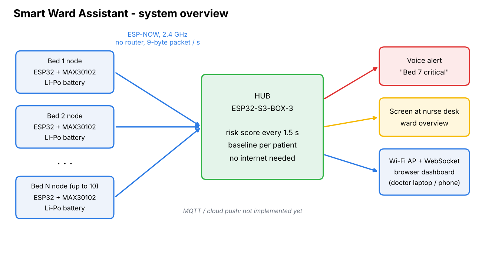
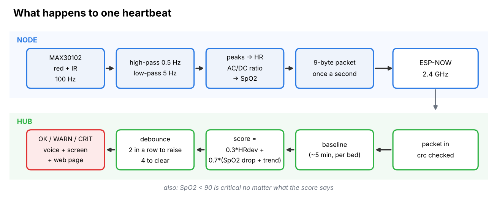
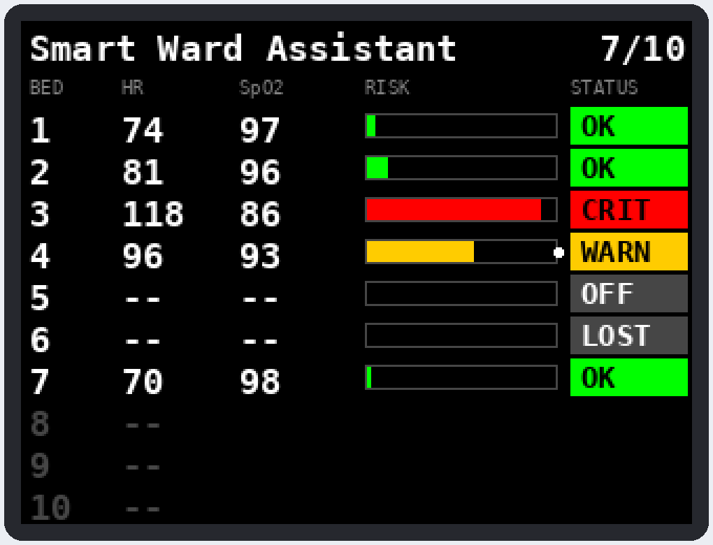
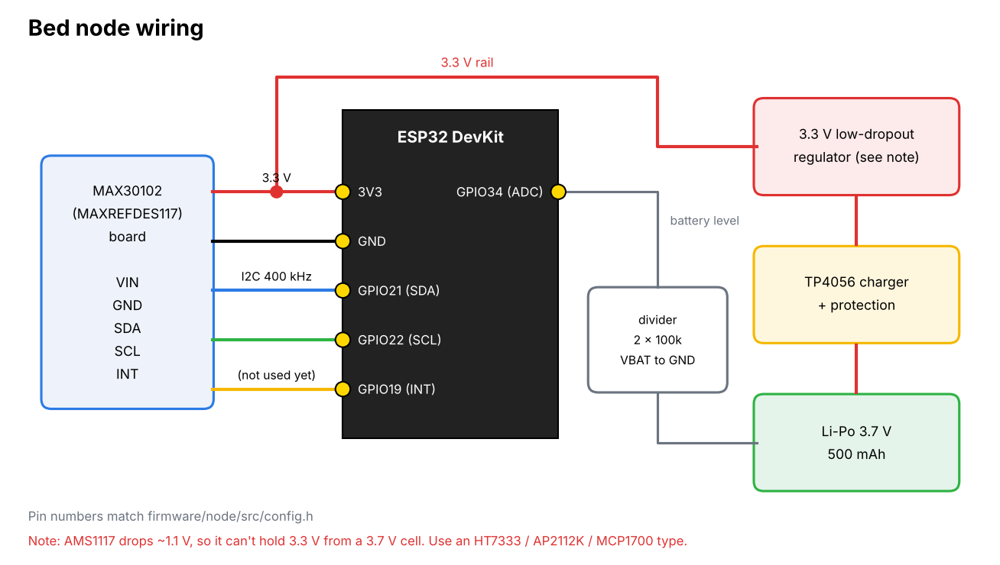
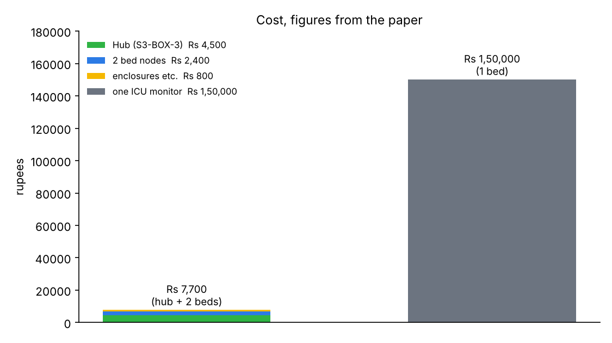
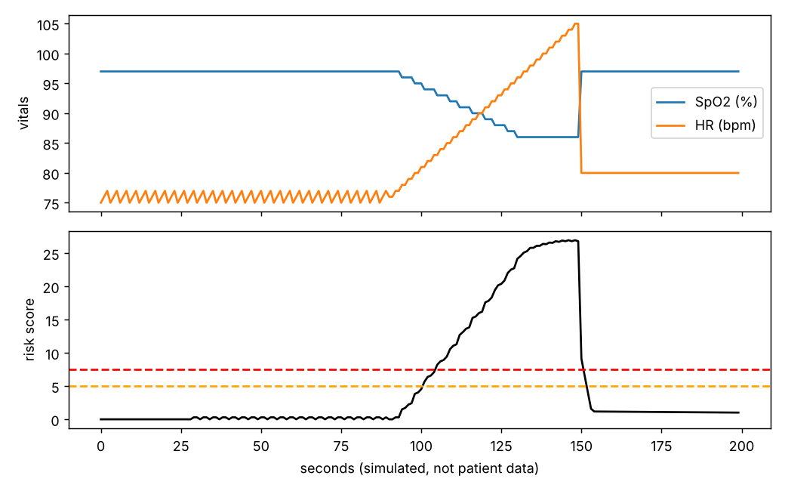

# Smart Ward Assistant

A cheap patient monitor for rural PHC wards that keeps working when the internet doesn't.

Every bed gets a small wrist/finger node (ESP32 + MAX30102) that measures heart rate and SpO2. The nodes talk to one hub (ESP32-S3-BOX-3) sitting at the nurse's desk using ESP-NOW, so there is no router and no cloud in the alarm path. The hub keeps a baseline for each patient, works out a risk score, and when a bed looks bad it says so out loud ("Bed 7, critical") and turns that row red on the screen.

I built this because in a PHC one nurse can have 10-15 beds and nothing between the 2 am and 4 am manual checks. A ward-grade monitor costs more than the whole ward budget; this costs about Rs 7,700 for a hub and two beds.



## How it works



**Node** (`firmware/node`)
- reads red and IR from the MAX30102 at 100 Hz
- removes the DC part, band-passes roughly 0.5-5 Hz
- heart rate from peak-to-peak time (average of the last 5 beats)
- SpO2 from the ratio of ratios, `SpO2 = A - B*R`
- sends a 9-byte packet once a second (bed id, HR, SpO2, battery, finger flag, crc)

**Hub** (`firmware/hub`)
- checks the packet, keeps a per-bed record
- baseline = slow average of HR and SpO2 for that patient (about 5 min), and it stops updating while the patient looks bad so a slow decline can't hide itself
- every 1.5 s: `score = 0.3 * HR_deviation + 0.7 * (SpO2_drop + 1.5 * fall_in_last_minute)`
- score under 5 is green, 5 to 7.5 is yellow, above 7.5 is red. SpO2 under 90 is red whatever the score is
- an alert needs 2 evaluations in a row, and it takes 4 good ones to clear, so one moved finger doesn't wake the ward
- a node that goes quiet for 10 s shows LOST and counts as a warning, sensor off a finger for a minute is a warning too
- the red alert repeats every 8 s until someone presses the button (or the Acknowledge button on the web page)

The weights and limits are all in `firmware/lib/swa_core/risk.h`.



*(that is a mock render of the layout in `display.cpp`, not a photo of the device)*

The hub also starts a Wi-Fi access point (`SWA-Ward`) and serves a page at `http://192.168.4.1` that shows every bed live over a WebSocket, worst bed first. No internet needed for that either.

## Repo layout

```
firmware/
  lib/swa_core/   packet format, ppg dsp, risk engine (plain c++, shared by node and hub)
  node/           bed node firmware (platformio)
  hub/            hub firmware (platformio) + data/ with web page and voice clips
  test/           pc tests for swa_core
tools/
  make_voice_clips.py   makes the spoken alerts (english / hindi / marathi)
  risk_sim.py           play with the risk weights on the pc
  make_images.py        redraws the pictures in docs/images
docs/
  hardware.md
```

## Hardware

Per bed: ESP32 dev board, MAX30102 / MAXREFDES117 board, 3.7 V 500 mAh Li-Po, TP4056 charger board, a 3.3 V regulator, two 100k resistors.
Hub: one ESP32-S3-BOX-3.



Note: the AMS1117 listed in the paper drops about 1.1 V, so with a 3.7 V cell it can't give a proper 3.3 V. Use a low-dropout part (HT7333, AP2112K, MCP1700). More detail in [docs/hardware.md](docs/hardware.md).



## Build and flash

You need [PlatformIO](https://platformio.org/). Both projects use the pioarduino platform because the code is written for Arduino core 3.x.

Hub first, because the nodes need to know its channel (and its MAC if you want to stop broadcasting):

```
cd firmware/hub
pio run -t upload
pio run -t uploadfs        # web page + voice clips
pio device monitor         # prints the hub mac
```

Then a node. Each bed has its own env in `firmware/node/platformio.ini`:

```
cd firmware/node
pio run -e bed1 -t upload
pio device monitor
```

For more than three beds copy one of the `[env:bedN]` blocks and change `BED_ID`.

Put the hub's MAC in `HUB_MAC` in `firmware/node/src/config.h`. It ships with the broadcast address so the first test works without it.

### Voice clips

```
pip install gTTS            # also needs ffmpeg
python tools/make_voice_clips.py en     # or hi, mr
cd firmware/hub && pio run -t uploadfs
```

Without the clips the hub still works: it plays a chime and then beeps the bed number, and a fast beep pattern for critical.

## Tests on the pc

```
cd firmware/test
make test
```

This feeds a fake PPG signal through the dsp (checks heart rate and SpO2 come out right), checks the packet crc, and runs the risk engine through a stable patient, a single glitch, a real SpO2 fall, recovery, and a patient who sits at 92 normally.

```
python tools/risk_sim.py --plot
```



That plot is a simulated patient, not recorded data.

## Status, and what is not done

Be careful with this section, it is the honest one.

- The dsp and risk code is tested on a pc (above). The node and hub firmware around it has **not been built or flashed from this snapshot**. I wrote the ESP32-S3-BOX-3 pin numbers and the ES8311 audio codec setup from the board docs; if the screen is blank or the speaker is silent, check `hub/src/config.h`, the display driver in `display.cpp` (ILI9341 vs ST7789, `LCD_INVERT`) and `codecInit()` in `audio.cpp` first.
- SpO2 uses the textbook `110 - 25*R`. It must be calibrated against a real oximeter before the numbers mean anything.
- The hub shows numbers only. The node does not stream the raw PPG wave yet, so no waveform on the screen or web page.
- The screen is drawn directly with Arduino_GFX, not LVGL.
- Voice alerts are recorded clips, not live text-to-speech. ESP-SR does speech recognition; the on-chip TTS that exists is Chinese only.
- MQTT / phone push is not implemented. It also conflicts with ESP-NOW: once the hub joins a router as a station, the radio moves to the router's channel and the nodes stop hearing it. It needs the nodes to follow the channel, or a second radio.
- ESP-NOW encryption is off.
- The node polls the sensor FIFO instead of using the INT pin, and does not use light sleep. Battery life has to be measured again with this code.
- Alert latency includes the debounce: roughly 1 s for the packet plus 2 x 1.5 s of confirmation. Set `confirmUp = 1` in `risk.h` if you would rather have faster alarms and accept more false ones.

## Not a medical device

This is a research prototype. It has not been clinically validated or certified and must not be the only thing watching a patient.

## License

Licensed under the [Apache License, Version 2.0](LICENSE).

## Author

Sumit R. Shingne, Dept. of Electronics and Telecommunication Engineering, Swaminarayan Siddhanta Institute of Technology, Nagpur.
